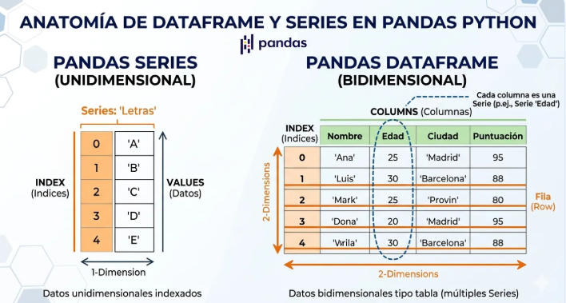
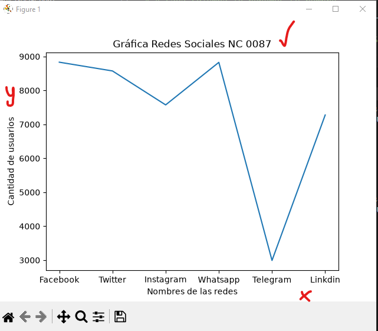
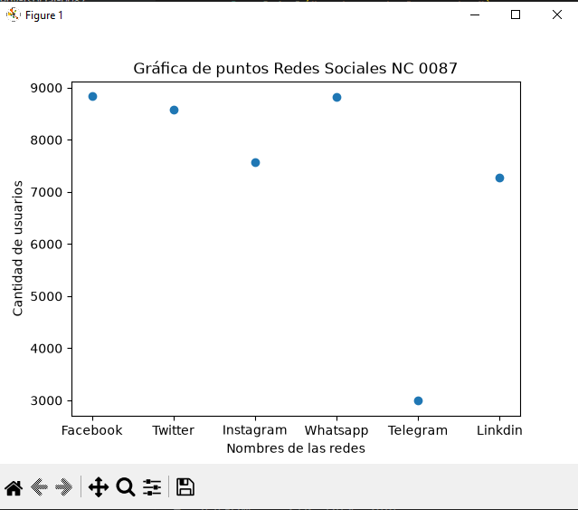
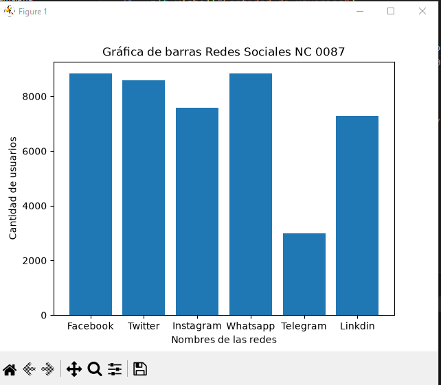
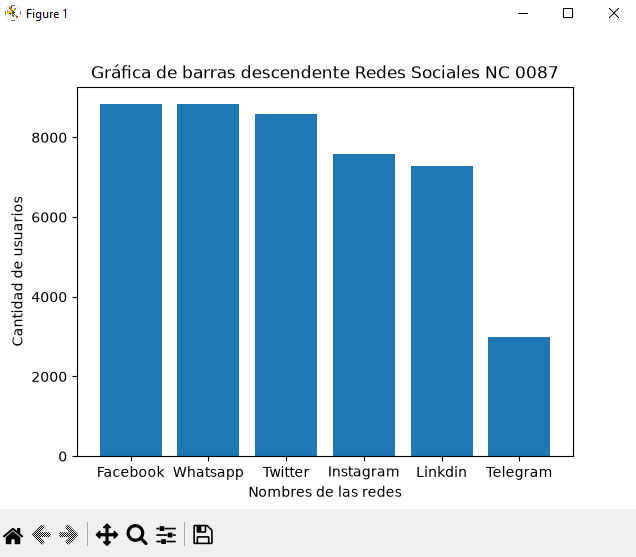
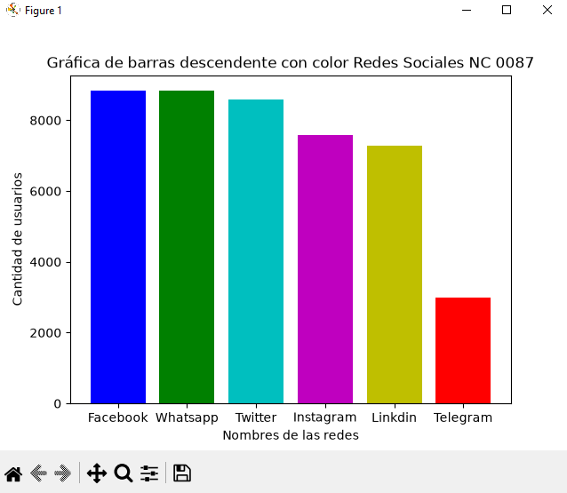
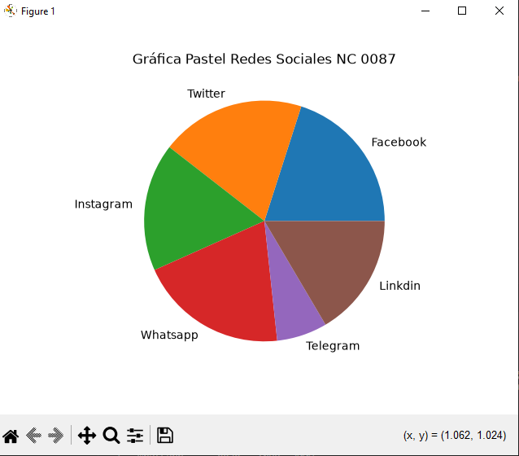

## dataframe o marco de datos pandas

## Redes sociales a nivel mundial

## Gráfica lineal de | Redes Sociales 

## Grafica de puntos | Redes Sociales

## Grafica de barras | Redes Sociales

## Grafica de barras del mas grande al mas chico descendente | Redes Sociales

## Grafica de barras con color | Redes Sociales

## Grafica pastel | Redes Sociales
